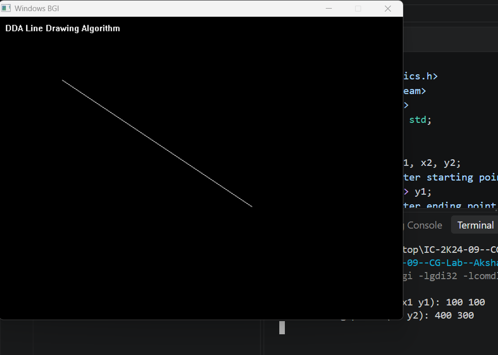

# Computer Graphics Lab Assignments

Practical lab assignments for the Computer Graphics course (MCA 5 Years).

---

## Table of Contents
- [Assignment 1: Basic Graphics Primitives](#assignment-1-basic-graphics-primitives)
- [Assignment 2: Digital Differential Analyzer (DDA) Line Generation Algorithm](#assignment-2-digital-differential-analyzer-dda-line-generation-algorithm)
- [Technologies & Requirements](#technologies--requirements)
- [Student Details](#student-details)

---

## Assignment 1: Basic Graphics Primitives

### Objective
To write a C++ program using the `graphics.h` library to draw basic graphics primitives in a single graphics window:
1. Straight Line (`line()`)
2. Circle (`circle()`)
3. Rectangle (`rectangle()`)
4. Triangle (using connected `line()` segments)

### Program File
- **Source Code:** [`CGM_lab1.cpp`](CGM_lab1.cpp)

### Output

---

## Assignment 2: Digital Differential Analyzer (DDA) Line Generation Algorithm

### Objective
To implement the DDA (Digital Differential Analyzer) line generation algorithm in C++ using `graphics.h`.

### Algorithm Overview
The DDA algorithm calculates pixel positions along a straight line by taking unit steps in one coordinate and generating corresponding fractional increments in the other:
1. Input endpoints: $(x_1, y_1)$ and $(x_2, y_2)$
2. Calculate differentials:
   $$\Delta x = x_2 - x_1$$
   $$\Delta y = y_2 - y_1$$
3. Determine steps:
   $$\text{steps} = \max(|\Delta x|, |\Delta y|)$$
4. Calculate increments per step:
   $$x_{\text{inc}} = \frac{\Delta x}{\text{steps}}$$
   $$y_{\text{inc}} = \frac{\Delta y}{\text{steps}}$$
5. Increment and plot successive points with screen center offset $(320 + \text{round}(x), 240 - \text{round}(y))$ using `putpixel()`.

### Program File
- **Source Code:** [`CGM_lab2.cpp`](CGM_lab2.cpp)

### Output

---

## Technologies & Requirements
- **Language:** C++
- **Graphics Library:** `graphics.h` (WinBGIm / MinGW 32-bit)
- **Compiler:** GCC / MinGW
- **Development Environment:** Visual Studio Code

---

## Student Details

- **Name:** Aaditya Malviya  
- **Roll Number:** IC-2K24-01  
- **Course:** MCA (5 Years)  
- **Subject:** Computer Graphics  
